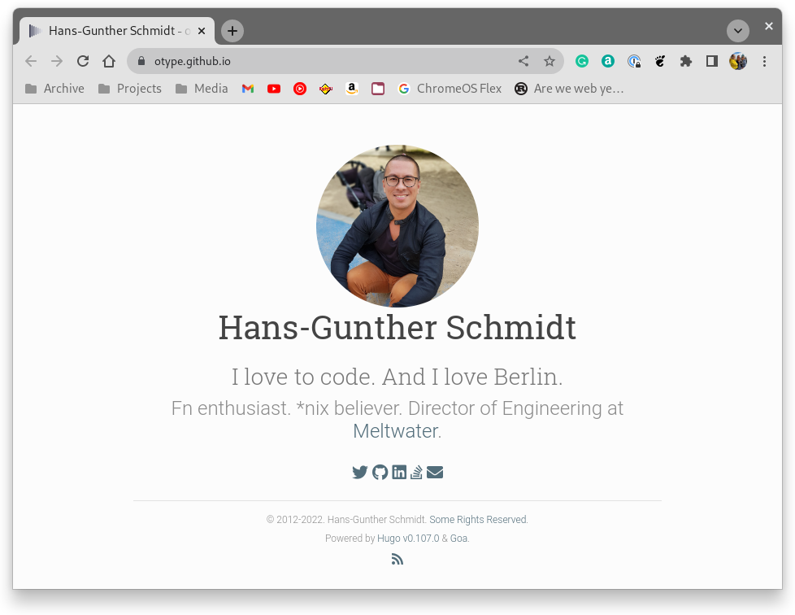

<div align="center">



# 🌐 otype.de

**The source of my personal website, built with [Hugo](https://gohugo.io/) and deployed to GitHub Pages.**

[](https://github.com/otype/otype.github.io/actions/workflows/hugo.yaml)
[](https://github.com/otype/otype.github.io/commits/main)
[](https://github.com/otype/otype.github.io/issues)
[](https://github.com/otype/otype.github.io/pulls)

[**→ otype.de**](https://otype.de)

</div>

---

This repository holds everything for [otype.de](https://otype.de). The older address [otype.github.io](https://otype.github.io) forwards to it automatically, so there is one site, not two copies. It is based on the [hugo-goa](https://github.com/shenoydotme/hugo-goa) theme, included as a git submodule.

## ✨ Highlights

- 🧱 **Hugo plus a small theme override.** The theme is a submodule; only the header and footer partials and a little CSS are changed here.
- 🔒 **No third-party requests on page load.** Fonts, Bootstrap, Font Awesome and highlight.js are self-hosted (see [`VENDORED_ASSETS.md`](VENDORED_ASSETS.md)).
- 🚀 **Deploys itself.** A GitHub Actions workflow builds and publishes the site whenever `main` changes.

## 🗂️ Project layout

```text
otype.github.io/
├── hugo.toml                 site config: URL, author, intro, social links
├── content/posts/            blog posts (Markdown)
├── archetypes/default.md     template for new posts (starts as a draft)
├── layouts/partials/         header and footer overrides for the theme
├── assets/img/, static/img/  author photos
├── static/css/custom.css     the site's own styles
├── static/fonts/, static/vendor/   self-hosted fonts and libraries
├── themes/hugo-goa/          the theme (git submodule)
├── .github/workflows/        hugo.yaml, the Pages deployment
├── Makefile                  shortcuts for running and building locally
└── VENDORED_ASSETS.md        where the self-hosted files come from, and when to re-check them
```

## 🚀 Getting started

### Requirements

- [Hugo](https://gohugo.io/installation/), for example `sudo pacman -S hugo` on Arch. The workflow uses the extended build and pins the version in `HUGO_VERSION` (currently 0.162.1), so a newer Hugo locally is fine.
- [git](https://git-scm.com/). The [GitHub CLI](https://cli.github.com/) is optional, it only makes cloning shorter.

### Clone with the theme

The theme is a submodule, so clone with `--recurse-submodules`:

```console
$ git clone --recurse-submodules https://github.com/otype/otype.github.io.git
$ cd otype.github.io
```

If you cloned without it, fetch the theme afterwards:

```console
$ git submodule update --init
```

### Run it locally

```console
$ hugo server        # http://localhost:1313, live-reloads on save (same as: make run)
$ hugo server -D     # also shows drafts
```

`make build` builds once into `public/` and includes drafts (`hugo -D`). `make clean` removes `public/` and `docs/`.

## ✍️ Writing a post

```console
$ hugo new posts/my-post.md
```

New posts come from the archetype with `draft: true`. The deployment builds **without** drafts, so a post only goes live once you set `draft: false` in its front matter. The existing `my-first-post.md` is still a draft, so it is not published.

## 🚢 Deploying

Make your change on a branch and open a pull request. When it is merged into `main`, the workflow [`hugo.yaml`](.github/workflows/hugo.yaml) runs by itself. You can also start it by hand from the Actions tab (`workflow_dispatch`).

1. install the pinned extended Hugo,
2. check out the repo including the theme submodule,
3. build with `hugo --gc --minify` for the Pages base URL,
4. upload `public/` and publish it with `actions/deploy-pages`.

Only one deploy runs at a time. The repository's Pages source is set to **GitHub Actions** and the custom domain is `otype.de` (Settings → Pages), with HTTPS enforced.

## 🎨 Theme and assets

Update the theme to its latest version and commit the new submodule pointer:

```console
$ git submodule update --remote themes/hugo-goa
```

The self-hosted libraries have no update automation. Re-check them against the "Where to check" links in [`VENDORED_ASSETS.md`](VENDORED_ASSETS.md) every 6 to 12 months, or sooner when a CVE for one of them is announced.

> [!NOTE]
> The Makefile targets `setup` and `deploy` are older shortcuts that no longer match this workflow. `make setup` clones the theme into a folder the submodule already owns, so use `git submodule update --init` instead. `make deploy` pushes straight to `main`, so use a pull request instead.
